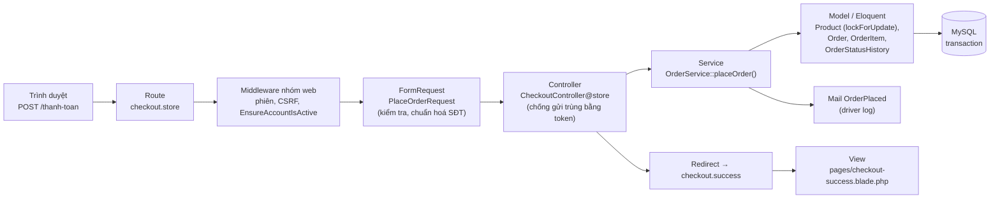

# CHƯƠNG 2. CƠ SỞ LÝ THUYẾT

Chương này trình bày các công nghệ nền tảng được sử dụng. Mỗi mục gồm khái niệm, đặc điểm, ưu – nhược điểm và một ví dụ minh hoạ trích từ mã nguồn dự án.

## 2.1. Ngôn ngữ PHP

**Khái niệm.** PHP (PHP: Hypertext Preprocessor) là ngôn ngữ kịch bản mã nguồn mở, chạy phía máy chủ, được thiết kế chủ yếu cho phát triển web [CẦN TRÍCH DẪN: php.net/manual].

**Đặc điểm.** Kiểu động có hỗ trợ khai báo kiểu tĩnh tuỳ chọn; từ PHP 8 có thêm `enum`, biểu thức `match`, thuộc tính `readonly`, `attribute` (`#[...]`), named arguments. Dự án yêu cầu PHP ≥ 8.3.

**Ưu điểm:** phổ biến, dễ triển khai trên hầu hết máy chủ web, hệ sinh thái lớn (Composer, Laravel), hiệu năng cải thiện rõ từ PHP 7/8. **Nhược điểm:** lịch sử nhiều hàm thiếu nhất quán; kiểu động dễ gây lỗi nếu không khai báo kiểu và không có kiểm thử.

**Ví dụ trong dự án** — `enum` + `match` mô tả luồng trạng thái đơn hàng (quy tắc nghiệp vụ 3), `app/Enums/OrderStatus.php`:

```php
public function transitions(): array
{
    return match ($this) {
        self::Pending => [self::Confirmed, self::Cancelled],
        self::Confirmed => [self::Shipping, self::Cancelled],
        self::Shipping => [self::Delivered],
        self::Delivered, self::Cancelled => [],
    };
}

public function canTransitionTo(self $next): bool
{
    return in_array($next, $this->transitions(), true);
}
```

## 2.2. Laravel Framework

**Khái niệm.** Laravel là framework PHP mã nguồn mở theo kiến trúc MVC, cung cấp sẵn định tuyến, middleware, ORM Eloquent, template Blade, xác thực, hàng đợi, kiểm thử… [CẦN TRÍCH DẪN: laravel.com/docs].

**Đặc điểm.** Cấu hình theo quy ước (convention over configuration); Service Container và dependency injection; định tuyến khai báo trong `routes/`; middleware xử lý chéo (phiên, CSRF, xác thực); FormRequest để kiểm tra dữ liệu; Policy để phân quyền theo đối tượng; migration để quản lý lược đồ CSDL theo phiên bản. Dự án dùng Laravel 13.

**Ưu điểm:** phát triển nhanh, cú pháp rõ ràng, tài liệu đầy đủ, bảo mật mặc định tốt (CSRF, mã hoá mật khẩu, chống SQL injection qua query builder). **Nhược điểm:** nhiều lớp trừu tượng nên tốn tài nguyên hơn PHP thuần; cần hiểu vòng đời request để gỡ lỗi.

**Ví dụ trong dự án** — nhóm route khu tài khoản dùng middleware `auth`, tiền tố URL tiếng Việt và route model binding theo mã đơn, `routes/web.php`:

```php
Route::middleware('auth')->prefix('tai-khoan')->name('account.')->group(function () {
    Route::get('/', Account\DashboardController::class)->name('dashboard');
    Route::get('/thong-tin', [Account\ProfileController::class, 'edit'])->name('profile.edit');
    Route::put('/thong-tin', [Account\ProfileController::class, 'update'])->name('profile.update');
    Route::get('/don-hang', [Account\OrderController::class, 'index'])->name('orders.index');
    Route::get('/don-hang/{order:code}', [Account\OrderController::class, 'show'])->name('orders.show');
    Route::post('/don-hang/{order:code}/huy', [Account\OrderController::class, 'cancel'])->name('orders.cancel');
});
```

## 2.3. Mô hình MVC

**Khái niệm.** MVC (Model – View – Controller) tách ứng dụng thành ba thành phần: *Model* biểu diễn dữ liệu và quy tắc truy cập dữ liệu; *View* hiển thị; *Controller* nhận yêu cầu, điều phối Model và chọn View trả về [CẦN TRÍCH DẪN].

**Áp dụng trong dự án.** Dự án dùng MVC **kết hợp lớp Service**: controller mỏng (chỉ nhận dữ liệu đã kiểm tra từ FormRequest, gọi service, trả view/redirect/JSON); toàn bộ nghiệp vụ nằm trong `app/Services` (`CartService`, `OrderService`, `ReportService`, `ChatService`). Cách tách này giúp tái sử dụng nghiệp vụ (ví dụ `OrderService::cancel()` dùng chung cho khách huỷ đơn và quản trị huỷ đơn) và dễ kiểm thử.

**Ưu điểm:** tách biệt trách nhiệm, dễ bảo trì và làm việc nhóm. **Nhược điểm:** nhiều tệp, cần quy ước rõ ràng để tránh dồn logic vào controller.

**Luồng một request thật — khách đặt hàng** (`POST /thanh-toan`):



**Ví dụ trong dự án** — controller mỏng, nghiệp vụ giao cho service, `app/Http/Controllers/CheckoutController.php`:

```php
public function store(PlaceOrderRequest $request): RedirectResponse
{
    $token = $request->validated('checkout_token');
    $session = $request->session();

    if ($token !== $session->get(self::TOKEN_KEY) || ! Cache::add('checkout-token:'.$token, true, now()->addHour())) {
        return $this->duplicate($request);
    }
    $session->forget(self::TOKEN_KEY);

    $order = $this->orders->placeOrder($request->orderData(), $request->user());

    $session->push(self::ORDERS_KEY, $order->code);
    $session->put(self::LAST_KEY, $order->code);

    return redirect()->route('checkout.success', $order)->with('status', __('order.placed', ['code' => $order->code]));
}
```

## 2.4. Hệ quản trị CSDL MySQL

**Khái niệm.** MySQL là hệ quản trị cơ sở dữ liệu quan hệ mã nguồn mở, dùng ngôn ngữ SQL; engine InnoDB hỗ trợ giao dịch ACID, khoá ngoại và khoá mức dòng [CẦN TRÍCH DẪN: dev.mysql.com/doc].

**Đặc điểm sử dụng trong dự án.** MySQL 8, bảng mã `utf8mb4` (lưu đầy đủ tiếng Việt có dấu); khoá ngoại có hành vi khi xoá rõ ràng (`cascade`, `set null`, `restrict`); chỉ mục ghép cho truy vấn thống kê; giao dịch và `SELECT … FOR UPDATE` khi trừ kho. Kiểm thử tự động chạy trên SQLite in-memory để nhanh và độc lập.

**Ưu điểm:** ổn định, phổ biến, hiệu năng tốt cho ứng dụng web vừa và nhỏ, hỗ trợ giao dịch. **Nhược điểm:** mở rộng ngang (sharding) phức tạp; một số khác biệt cú pháp so với các hệ khác (cần chú ý khi chạy test trên SQLite).

**Ví dụ trong dự án** — bảng `orders` với khoá ngoại và hành vi khi xoá, `database/migrations/2026_10_19_110200_create_orders_table.php`:

```php
Schema::create('orders', function (Blueprint $table) {
    $table->id();
    $table->string('code', 20)->unique();
    // Đơn phải còn khi xoá user: user_id về null (thông tin giao hàng đã lưu trong đơn)
    $table->foreignId('user_id')->nullable()->constrained()->nullOnDelete();
    $table->foreignId('coupon_id')->nullable()->constrained()->restrictOnDelete();
    $table->string('receiver_name', 100);
    $table->string('phone', 20);
    // …
});
```

Chỉ mục ghép phục vụ thống kê doanh thu (`…_add_status_created_at_index_to_orders_table.php`): `$table->index(['status', 'created_at']);`.

## 2.5. Eloquent ORM

**Khái niệm.** Eloquent là ORM (Object-Relational Mapping) của Laravel theo mẫu Active Record: mỗi bảng tương ứng một lớp Model, mỗi dòng là một đối tượng [CẦN TRÍCH DẪN: laravel.com/docs/eloquent].

**Đặc điểm.** Khai báo quan hệ (`belongsTo`, `hasMany`, `hasOne`); *scope* tái sử dụng điều kiện truy vấn; *accessor* tính thuộc tính dẫn xuất; *cast* tự chuyển kiểu (enum, boolean, datetime); *eager loading* (`with()`) tránh lỗi N+1; xoá mềm (`SoftDeletes`).

**Ưu điểm:** mã truy vấn ngắn gọn, dễ đọc, an toàn trước SQL injection. **Nhược điểm:** dễ phát sinh N+1 truy vấn nếu quên eager loading (dự án bật `Model::preventLazyLoading()` khi chạy test để phát hiện sớm); truy vấn tổng hợp phức tạp đôi khi cần SQL thô.

**Ví dụ trong dự án** — scope và accessor hiện thực quy tắc giá hiện hành (quy tắc 1), `app/Models/Product.php`:

```php
#[Scope]
protected function onSale(Builder $query): void
{
    $query->whereNotNull('sale_price')->whereColumn('sale_price', '<', 'price');
}

/** Giá hiện hành: sale_price nếu có và nhỏ hơn price, ngược lại price (quy tắc 1) */
protected function currentPrice(): Attribute
{
    return Attribute::get(fn (): int => $this->is_on_sale ? $this->sale_price : $this->price);
}

protected function isOnSale(): Attribute
{
    return Attribute::get(fn (): bool => $this->sale_price !== null && $this->sale_price < $this->price);
}
```

Sử dụng: `Product::query()->active()->onSale()->with(['images', 'brand'])->orderByDiscount()->limit(8)->get()` (khối "Đang ưu đãi" ở `HomeController`).

## 2.6. Blade Template

**Khái niệm.** Blade là template engine của Laravel; tệp `.blade.php` được biên dịch sang PHP thuần và lưu đệm [CẦN TRÍCH DẪN: laravel.com/docs/blade].

**Đặc điểm.** Kế thừa layout (`@extends`, `@section`, `@yield`); component (`<x-…>`) dạng lớp hoặc ẩn danh; chỉ thị điều kiện/vòng lặp (`@if`, `@foreach`); tự động escape đầu ra `{{ }}` chống XSS; chỉ thị `@csrf`, `@method`, `@error`.

**Ưu điểm:** cú pháp gọn, an toàn mặc định, tái sử dụng giao diện tốt. **Nhược điểm:** dễ bị nhồi logic vào view nếu thiếu quy ước (dự án quy định không để logic trong Blade — dữ liệu hiển thị được chuẩn bị ở controller, View Component hoặc accessor).

**Ví dụ trong dự án** — trang giỏ hàng kế thừa layout chung và dùng component, `resources/views/pages/cart.blade.php`:

```blade
@extends('layouts.app')

@section('title', 'Giỏ hàng')

@section('content')
    <div class="container py-6">
        <x-breadcrumb :items="[['label' => 'Giỏ hàng']]" class="mb-4" />
        <h1 class="t-title mb-5">Giỏ hàng</h1>

        @if ($items->isEmpty())
            <x-empty-state title="Giỏ hàng của bạn đang trống" text="Xem các sản phẩm đang ưu đãi hoặc tìm sản phẩm bạn cần."
                :action-url="route('products.index')" action-label="Xem sản phẩm" />
        @else
            {{-- bảng dòng giỏ hàng … --}}
        @endif
    </div>
@endsection
```

## 2.7. Bootstrap

**Khái niệm.** Bootstrap là framework CSS mã nguồn mở cung cấp hệ thống lưới 12 cột responsive, thành phần giao diện (form, bảng, card, alert, badge, navbar, offcanvas, accordion…) và tiện ích CSS [CẦN TRÍCH DẪN: getbootstrap.com/docs/5.3].

**Đặc điểm sử dụng trong dự án.** Bootstrap 5.3 biên dịch từ mã nguồn Sass qua Vite; biến Sass được tuỳ biến theo nhận diện thương hiệu (màu chủ đạo, góc vuông, tắt bóng đổ và gradient, thang khoảng cách 4/8 px); chỉ nhập các module cần dùng. Phần JavaScript của Bootstrap dùng cho dropdown, offcanvas (menu điện thoại, khung chat), collapse/accordion (bộ lọc, FAQ).

**Ưu điểm:** dựng giao diện responsive nhanh, đồng nhất, có sẵn khả năng truy cập cơ bản. **Nhược điểm:** giao diện mặc định dễ "giống nhau" giữa các website nếu không tuỳ biến; kích thước CSS lớn nếu nạp toàn bộ.

**Ví dụ trong dự án** — form thanh toán dùng lưới, card, form-control và trạng thái lỗi, `resources/views/pages/checkout.blade.php` (trích rút gọn):

```blade
<form method="POST" action="{{ route('checkout.store') }}" class="row g-6" novalidate>
    @csrf
    <input type="hidden" name="checkout_token" value="{{ $token }}">
    <div class="col-lg-7">
        <fieldset class="card card-body mb-5">
            <legend class="h5 mb-4">Thông tin người nhận</legend>
            <div class="row g-4">
                <div class="col-md-6">
                    <label for="receiver_name" class="form-label">Họ tên</label>
                    <input id="receiver_name" name="receiver_name" type="text" required
                        class="form-control @error('receiver_name') is-invalid @enderror">
                    @error('receiver_name') <div class="invalid-feedback">{{ $message }}</div> @enderror
                </div>
```

Tuỳ biến biến Sass (`resources/scss/_bootstrap-config.scss`): `$enable-shadows: false;`, `$enable-gradients: false;`, `$primary: $c-men-ngoc;`, `$border-radius: 0;`.
