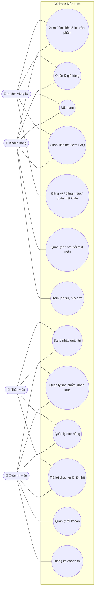
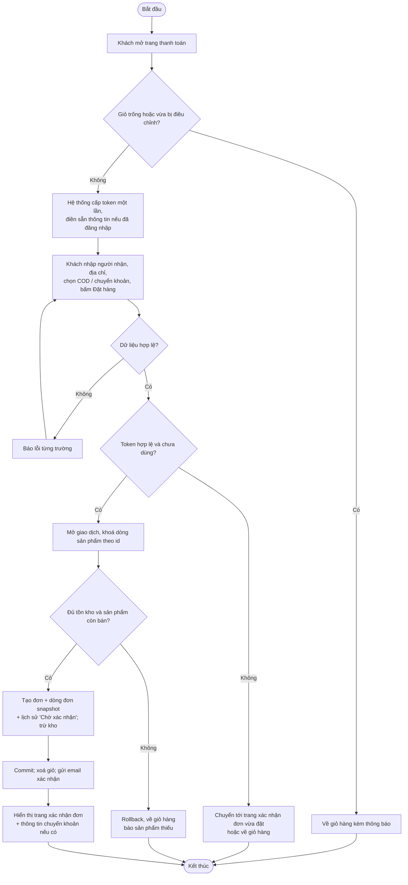
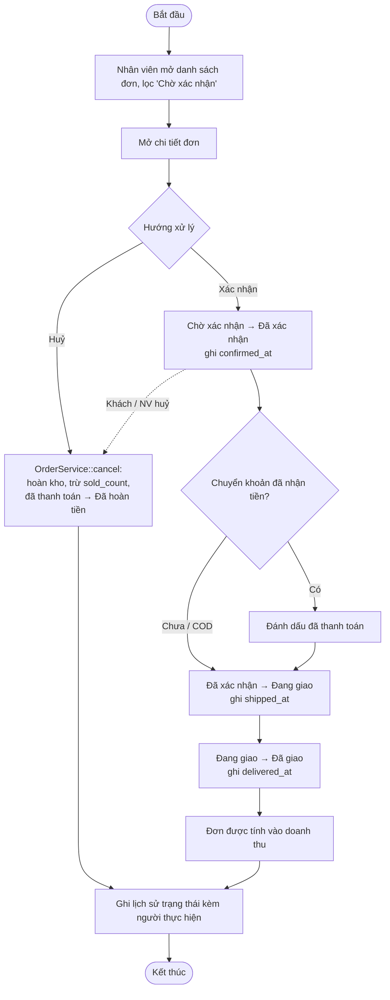
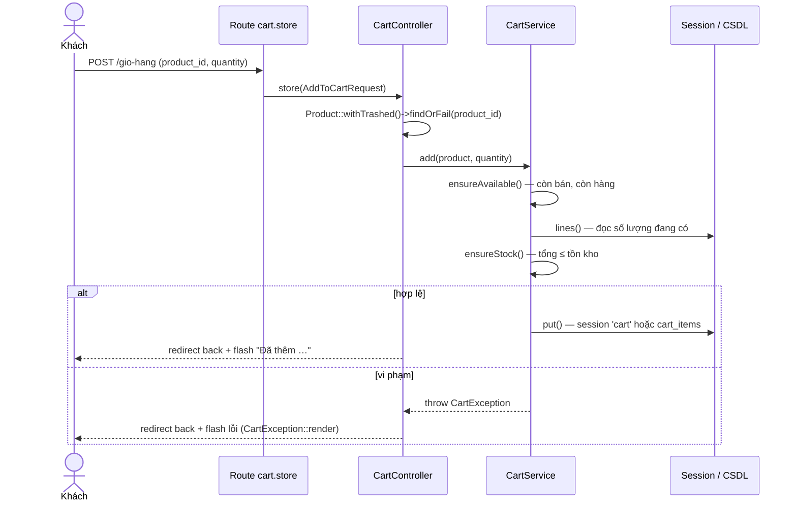
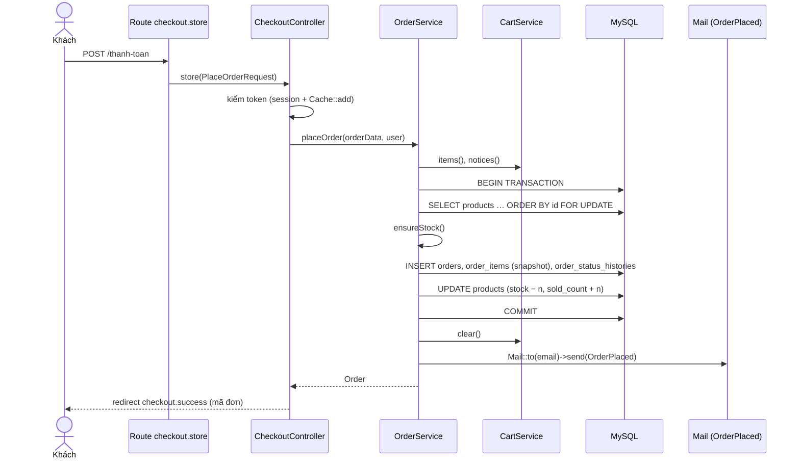
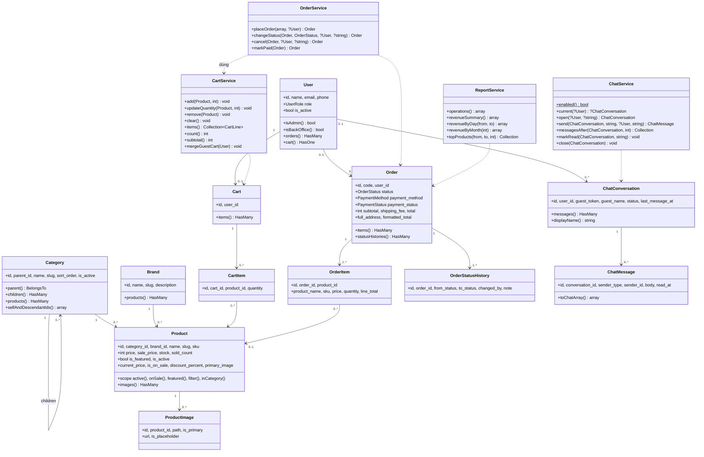
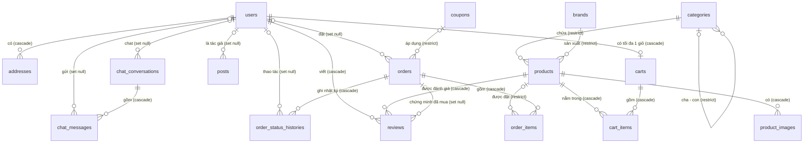

# CHƯƠNG 3. PHÂN TÍCH VÀ THIẾT KẾ HỆ THỐNG

## 3.1. Xác định yêu cầu

### 3.1.1. Tác nhân

| Tác nhân | Mô tả |
|---|---|
| Khách vãng lai | Chưa đăng nhập; xem/tìm sản phẩm, giỏ hàng lưu trong phiên, đặt hàng, chat, gửi liên hệ |
| Khách hàng | Đã đăng nhập (vai trò `customer`); thêm hồ sơ, đổi mật khẩu, lịch sử và huỷ đơn; giỏ lưu CSDL |
| Nhân viên | Vai trò `staff`; quản lý sản phẩm, danh mục (không xoá), đơn hàng, chat, tin liên hệ |
| Quản trị viên | Vai trò `admin`; toàn quyền, gồm xoá dữ liệu, quản lý tài khoản, thống kê doanh thu |
| Hệ thống email | Nhận yêu cầu gửi mail xác nhận đơn / đặt lại mật khẩu (driver `log` khi demo) |

### 3.1.2. Yêu cầu chức năng (theo 10 nhóm đề cương — phần đã thực hiện)

| Nhóm | Yêu cầu chức năng | Route chính |
|---|---|---|
| 1. Trang chủ | Hiển thị banner, giới thiệu, sản phẩm nổi bật, đang ưu đãi, danh mục | `home` |
| 2. Sản phẩm | Danh sách theo danh mục / thương hiệu; chi tiết sản phẩm | `products.index`, `categories.show`, `brands.show`, `products.show` |
| 3. Giỏ hàng | Thêm, cập nhật số lượng, xoá; tính tạm tính; gộp giỏ khi đăng nhập | `cart.index`, `cart.store`, `cart.update`, `cart.destroy` |
| 4. Thanh toán | Nhập thông tin giao hàng, chọn COD / chuyển khoản, xác nhận đơn, gửi email | `checkout.create`, `checkout.store`, `checkout.success` |
| 5. Tài khoản | Đăng ký, đăng nhập, quên/đặt lại mật khẩu; hồ sơ, đổi mật khẩu, lịch sử đơn, huỷ đơn | `register`, `login`, `password.request`, `account.*` |
| 6. Quản trị | Đăng nhập quản trị; quản lý sản phẩm, danh mục, đơn hàng, tài khoản; thống kê doanh thu | `admin.login`, `admin.products.*`, `admin.categories.*`, `admin.orders.*`, `admin.users.*`, `admin.reports.index` |
| 7. Tìm kiếm & lọc | Tìm theo từ khoá; lọc giá, danh mục, thương hiệu, đang giảm giá | `products.index` (`?q=&danh-muc=&thuong-hieu[]=&gia-tu=&gia-den=&khuyen-mai=1`) |
| 9. Hỗ trợ | Chat trực tuyến (polling), form liên hệ, FAQ; quản trị trả lời chat, xử lý tin liên hệ | `chat.messages`, `chat.send`, `contact.create`, `contact.store`, `faq.index`, `admin.chats.*`, `admin.contacts.*` |
| 10. Khuyến mãi | Giá khuyến mãi theo sản phẩm (mã giảm giá đã cắt) | — (thuộc tính `sale_price`) |

Nhóm 8 (đánh giá & bình luận) nằm ngoài phạm vi (mục 1.3.2).

### 3.1.3. Yêu cầu phi chức năng

| Loại | Yêu cầu | Cách đáp ứng trong hệ thống |
|---|---|---|
| Bảo mật | Mật khẩu băm; chống CSRF, XSS, SQL injection; phân quyền | Cast `hashed` (bcrypt); `@csrf`; Blade tự escape, mô tả Markdown lọc HTML; Eloquent/Query Builder dùng tham số; middleware `role` + Policy |
| Chống lạm dụng | Giới hạn tần suất | Đăng nhập 5 lần sai/phút (`LoginRequest`); quên mật khẩu (`throttle:6,1`); liên hệ 3 lượt/10 phút + honeypot; chat 20 tin/phút |
| Toàn vẹn dữ liệu | Không bán quá tồn kho; đơn không bị sửa giá về sau | Giao dịch + `lockForUpdate()`; snapshot giá trong `order_items` |
| Hiệu năng | Không phát sinh truy vấn N+1; trang tải nhanh | Eager loading (`with()`), `preventLazyLoading()` khi chạy test; cache menu và cài đặt; Chart.js chỉ tải ở trang thống kê |
| Khả dụng | Giao diện tiếng Việt, responsive | Bootstrap 5, giao diện mobile-first, thông báo lỗi tiếng Việt (`lang/vi`), trang lỗi 404/403/419/429/500 tiếng Việt |
| Tin cậy | Kiểm chứng tự động | 410 test tự động (Pest), gồm test kiểm link và kịch bản demo end-to-end |
| Khả chuyển | Chạy sau proxy (demo qua Cloudflare Tunnel) | `trustProxies`, ảnh dùng đường dẫn tương đối `/storage/...` |

## 3.2. Biểu đồ Use Case

### 3.2.1. Biểu đồ Use Case tổng quát



Ghi chú: Khách hàng kế thừa các use case của Khách vãng lai; Quản trị viên kế thừa các use case của Nhân viên và có thêm quản lý tài khoản, thống kê (quy tắc 9). Biểu tượng tác nhân dùng ký tự để hiển thị trong Mermaid; khi đưa vào báo cáo Word có thể vẽ lại bằng công cụ UML.

### 3.2.2. Đặc tả Use Case

**UC – Đăng nhập**

| Mục | Nội dung |
|---|---|
| Tác nhân | Khách hàng; Nhân viên / Quản trị viên (qua `/admin/login`) |
| Tiền điều kiện | Chưa đăng nhập; tài khoản tồn tại và đang hoạt động (`is_active = 1`) |
| Luồng chính | 1. Người dùng mở `/dang-nhap` (hoặc `/admin/login`). 2. Nhập email, mật khẩu (tuỳ chọn "Ghi nhớ"). 3. `LoginRequest::authenticate()` kiểm tra giới hạn tần suất và thông tin đăng nhập. 4. Hệ thống tạo lại phiên; listener `MergeGuestCart` gộp giỏ khách vào giỏ CSDL. 5. Chuyển hướng: admin/staff → `/admin`, khách hàng → trang chủ. |
| Luồng thay thế | 3a. Sai email/mật khẩu hoặc tài khoản bị khoá → báo "Email hoặc mật khẩu không đúng." 3b. Sai quá 5 lần/phút → báo chờ N giây. 3c. Tài khoản khách hàng đăng nhập ở `/admin/login` → từ chối với thông báo chung, không giữ phiên. |
| Hậu điều kiện | Người dùng đã đăng nhập; giỏ hàng phiên (nếu có) đã gộp vào CSDL |

**UC – Tìm kiếm & lọc sản phẩm**

| Mục | Nội dung |
|---|---|
| Tác nhân | Khách vãng lai, Khách hàng |
| Tiền điều kiện | Không |
| Luồng chính | 1. Khách nhập từ khoá ở ô tìm kiếm hoặc mở `/san-pham`. 2. Chọn danh mục, thương hiệu, khoảng giá, "Đang giảm giá" và bấm Lọc. 3. `ProductFilterRequest::filters()` chuẩn hoá tham số; scope `Product::filter()` áp điều kiện. 4. Hệ thống hiển thị số kết quả và 12 sản phẩm/trang, phân trang giữ tham số lọc. |
| Luồng thay thế | 3a. Tham số sai (giá chữ, giá âm, giá đến < giá từ…) → bị bỏ qua, không báo lỗi. 4a. Không có kết quả → hiển thị trạng thái trống và nút "Xoá bộ lọc". |
| Hậu điều kiện | Danh sách sản phẩm đang bán thoả điều kiện được hiển thị |

**UC – Thêm vào giỏ hàng**

| Mục | Nội dung |
|---|---|
| Tác nhân | Khách vãng lai, Khách hàng |
| Tiền điều kiện | Sản phẩm đang bán, còn hàng |
| Luồng chính | 1. Khách chọn số lượng và bấm "Thêm vào giỏ". 2. `AddToCartRequest` kiểm tra dữ liệu. 3. `CartService::add()` kiểm tra sản phẩm còn bán và tổng số lượng không vượt tồn kho. 4. Lưu vào phiên (khách vãng lai) hoặc bảng `cart_items` (khách hàng). 5. Quay lại trang trước, thông báo thành công; badge giỏ cập nhật. |
| Luồng thay thế | 3a. Sản phẩm ngừng bán / hết hàng / vượt tồn kho → `CartException`, quay lại kèm thông báo lỗi, giỏ giữ nguyên. |
| Hậu điều kiện | Giỏ hàng chứa sản phẩm với số lượng hợp lệ |

**UC – Đặt hàng**

| Mục | Nội dung |
|---|---|
| Tác nhân | Khách vãng lai, Khách hàng; Hệ thống email |
| Tiền điều kiện | Giỏ hàng không rỗng |
| Luồng chính | 1. Khách mở `/thanh-toan`; hệ thống cấp token một lần, điền sẵn thông tin nếu đã đăng nhập. 2. Khách nhập người nhận, địa chỉ, chọn COD hoặc chuyển khoản, bấm "Đặt hàng". 3. `PlaceOrderRequest` kiểm tra dữ liệu; `CheckoutController@store` kiểm tra token. 4. `OrderService::placeOrder()` trong giao dịch: khoá dòng sản phẩm, kiểm lại tồn kho, tạo đơn (mã `MP-YYYYMMDD-XXXX`), lưu dòng đơn dạng snapshot, ghi lịch sử, trừ kho. 5. Xoá giỏ, gửi email `OrderPlaced`. 6. Chuyển tới trang xác nhận (hiển thị thông tin chuyển khoản nếu chọn chuyển khoản). |
| Luồng thay thế | 1a. Giỏ trống → về giỏ hàng kèm thông báo. 3a. Dữ liệu sai → báo lỗi từng trường. 3b. Gửi trùng (bấm hai lần / F5) → không tạo đơn mới, chuyển tới trang xác nhận đơn vừa đặt. 4a. Giỏ vừa thay đổi hoặc thiếu hàng lúc khoá dòng → rollback, về giỏ hàng báo rõ sản phẩm thiếu. |
| Hậu điều kiện | Đơn ở trạng thái "Chờ xác nhận", chưa thanh toán; tồn kho đã trừ; email đã gửi |

**UC – Quản lý sản phẩm**

| Mục | Nội dung |
|---|---|
| Tác nhân | Nhân viên (thêm, sửa), Quản trị viên (thêm, sửa, xoá mềm, khôi phục) |
| Tiền điều kiện | Đã đăng nhập khu quản trị |
| Luồng chính | 1. Mở `/admin/products`, tìm theo tên/SKU, lọc danh mục/trạng thái. 2. Thêm hoặc sửa: nhập danh mục, thương hiệu, tên, SKU, giá, giá khuyến mãi, tồn kho, mô tả, ảnh chính. 3. `ProductRequest` kiểm tra; slug sinh tự động bằng `Slug::unique()`; ảnh lưu vào disk `public`. 4. Lưu và thông báo thành công. |
| Luồng thay thế | 3a. Giá khuyến mãi ≥ giá, SKU trùng, thiếu trường → báo lỗi. 1a. Quản trị viên xoá → xoá mềm (khách không thấy); có thể khôi phục. 1b. Nhân viên xoá → 403 (`ProductPolicy`). |
| Hậu điều kiện | Sản phẩm được cập nhật trong CSDL |

**UC – Quản lý đơn hàng**

| Mục | Nội dung |
|---|---|
| Tác nhân | Nhân viên, Quản trị viên |
| Tiền điều kiện | Đã đăng nhập khu quản trị; đơn tồn tại |
| Luồng chính | 1. Mở `/admin/orders`, lọc theo trạng thái / tìm theo mã, tên, SĐT. 2. Mở chi tiết đơn: sản phẩm, tổng tiền, địa chỉ, lịch sử trạng thái. 3. Chọn trạng thái kế tiếp hợp lệ (xác nhận → đang giao → đã giao) và cập nhật. 4. `OrderService::changeStatus()` kiểm tra luồng, ghi mốc thời gian và lịch sử kèm người thực hiện. |
| Luồng thay thế | 3a. Chọn "Đã huỷ" (chỉ khi chờ/đã xác nhận) → `OrderService::cancel()` hoàn kho; đơn đã thanh toán chuyển "Đã hoàn tiền". 3b. Chuyển sai luồng → báo lỗi, giữ nguyên trạng thái. 3c. "Đánh dấu đã thanh toán" → `OrderService::markPaid()`. Không có chức năng xoá đơn (quy tắc 11). |
| Hậu điều kiện | Trạng thái đơn và lịch sử được cập nhật |

**UC – Thống kê doanh thu**

| Mục | Nội dung |
|---|---|
| Tác nhân | Quản trị viên |
| Tiền điều kiện | Đã đăng nhập với vai trò admin |
| Luồng chính | 1. Mở `/admin/reports`. 2. (Tuỳ chọn) chọn khoảng ngày. 3. `ReportService` tính doanh thu đơn **đã giao** theo ngày (`revenueByDay`), theo 12 tháng (`revenueByMonth`) và top 10 sản phẩm bán chạy (`topProducts`). 4. Hiển thị biểu đồ đường (Chart.js) và bảng số liệu. |
| Luồng thay thế | 1a. Nhân viên truy cập → 403. 2a. Ngày sai định dạng / đảo ngược / quá 366 ngày → dùng mặc định 30 ngày gần nhất. |
| Hậu điều kiện | Không thay đổi dữ liệu |

**UC – Chat trực tuyến**

| Mục | Nội dung |
|---|---|
| Tác nhân | Khách vãng lai, Khách hàng; Nhân viên, Quản trị viên |
| Tiền điều kiện | Chức năng chat đang bật (`chat_enabled = 1`) |
| Luồng chính | 1. Khách bấm nút "Chat", khung chat mở; trình duyệt gọi `GET /chat/tin-nhan?sau=ID` mỗi 5 giây. 2. Khách gửi tin (`POST /chat/tin-nhan`); khách vãng lai nhập tên ở tin đầu. 3. `ChatService::open()` lấy/mở hội thoại theo `user_id` hoặc `guest_token` trong phiên; `ChatService::send()` lưu tin. 4. Nhân viên mở `/admin/chats` (hội thoại có tin chưa đọc lên đầu), xem và trả lời; trang quản trị cũng cập nhật mỗi 5 giây. 5. Tin mới của phía kia hiện ở lần cập nhật kế tiếp và được đánh dấu đã đọc. |
| Luồng thay thế | 2a. Khách vãng lai chưa nhập tên → 422. 2b. Tin > 1000 ký tự hoặc gửi quá 20 tin/phút → bị từ chối. 1a. Chat tắt → API trả 404, nút ẩn. 4a. Nhân viên đóng hội thoại; khách nhắn tiếp thì hội thoại mở lại. |
| Hậu điều kiện | Tin nhắn được lưu trong `chat_messages` |

## 3.3. Biểu đồ hoạt động (Activity)

### 3.3.1. Đặt hàng



### 3.3.2. Xử lý đơn ở khu quản trị



## 3.4. Biểu đồ tuần tự (Sequence)

### 3.4.1. Thêm sản phẩm vào giỏ



### 3.4.2. Đặt hàng



### 3.4.3. Đổi trạng thái đơn (quản trị)

```mermaid
sequenceDiagram
    actor N as Nhân viên
    participant C as Admin\OrderController
    participant P as OrderPolicy
    participant O as OrderService
    participant DB as MySQL
    N->>C: PATCH /admin/orders/{code}/status (status, note)
    C->>P: UpdateOrderStatusRequest::authorize() → updateStatus
    C->>O: changeStatus(order, to, user, note)
    alt to = cancelled
        O->>O: cancel(order, user, note)
        O->>DB: khoá đơn + sản phẩm; hoàn stock; status = cancelled
    else xác nhận / giao / đã giao
        O->>DB: BEGIN; SELECT order FOR UPDATE
        O->>O: status->canTransitionTo(to)?
        O->>DB: UPDATE status + confirmed_at/shipped_at/delivered_at
        O->>DB: INSERT order_status_histories (changed_by)
        O->>DB: COMMIT
    end
    C-->>N: redirect chi tiết đơn + flash
    Note over O: Sai luồng → InvalidOrderTransitionException → flash lỗi
```

### 3.4.4. Chat (polling)

```mermaid
sequenceDiagram
    actor K as Khách (chat.js)
    participant CC as ChatController
    participant CH as ChatService
    participant DB as MySQL
    actor N as Nhân viên (trang /admin/chats/{id})
    loop mỗi 5 giây khi khung chat mở
        K->>CC: GET /chat/tin-nhan?sau=lastId
        CC->>CH: current(user) → hội thoại theo user_id / guest_token
        CC->>CH: markRead(…, customer); messagesAfter(…, lastId)
        CH->>DB: SELECT chat_messages WHERE id > lastId
        CC-->>K: JSON {messages, needs_name}
    end
    K->>CC: POST /chat/tin-nhan (body, name?)
    CC->>CH: open(user, name); send(conversation, 'customer', user, body)
    CH->>DB: INSERT chat_messages; UPDATE last_message_at
    N->>N: polling GET /admin/chats/{id}/messages?sau=…
    N->>CH: (Admin\ChatController) send(conversation, 'staff', staff, body)
```

## 3.5. Biểu đồ lớp (Class Diagram)



Các lớp giá trị/enum liên quan: `CartLine` (dòng giỏ: `product`, `quantity`, `unitPrice`, `lineTotal`), `OrderStatus` (`transitions()`, `canTransitionTo()`), `PaymentMethod`, `PaymentStatus`, `UserRole`, `SkinType`.

## 3.6. Mô hình thực thể – liên kết (ERD)

Sơ đồ đầy đủ (kèm danh sách cột) nằm trong `docs/erd.mmd`. Dưới đây là phần quan hệ giữa các bảng nghiệp vụ:



**Ghi chú phạm vi:** các bảng `reviews`, `coupons`, `banners` (chỉ đọc từ dữ liệu mẫu, không có quản trị), `posts` và `addresses` vẫn có trong lược đồ (được thiết kế từ đầu theo đề cương) nhưng **không được sử dụng** hoặc chỉ dùng một phần do phạm vi rút gọn ngày 19/10/2026; `orders.coupon_id` luôn rỗng và `orders.discount` luôn bằng 0. Giữ nguyên các bảng này giúp mở rộng về sau mà không phải đổi lược đồ.

## 3.7. Thiết kế cơ sở dữ liệu

### 3.7.1. Các bảng chính

Tổng cộng 20 bảng nghiệp vụ (chưa kể bảng hạ tầng của Laravel). Từ điển dữ liệu đầy đủ: `docs/data-dictionary.md`.

| Bảng | Cột quan trọng | Khoá / ràng buộc |
|---|---|---|
| `users` | name, email, phone, password (băm), role (`admin`/`staff`/`customer`), is_active | PK `id`; UNIQUE `email`; INDEX `role` |
| `categories` | parent_id, name, slug, sort_order, is_active | PK; UNIQUE `slug`; FK `parent_id` → categories (restrict) |
| `brands` | name, slug, description, is_active | PK; UNIQUE `slug` |
| `products` | category_id, brand_id, name, slug, sku, price, sale_price, stock, sold_count, is_featured, is_active, deleted_at | PK; UNIQUE `slug`, `sku`; FK → categories, brands (restrict); xoá mềm |
| `product_images` | product_id, path, is_primary, sort_order | PK; FK → products (cascade) |
| `carts` / `cart_items` | user_id; cart_id, product_id, quantity | `carts.user_id` UNIQUE, bắt buộc; UNIQUE (`cart_id`, `product_id`); cascade |
| `orders` | code, user_id, receiver_name, phone, email, province, district, ward, detail, payment_method, payment_status, status, subtotal, discount, shipping_fee, total, confirmed_at, shipped_at, delivered_at, cancelled_at | PK; UNIQUE `code`; FK `user_id` (set null); INDEX (`status`, `created_at`) |
| `order_items` | order_id, product_id, product_name, sku, price, quantity, line_total | FK `order_id` (cascade), `product_id` (restrict) |
| `order_status_histories` | order_id, from_status, to_status, changed_by, note | FK `order_id` (cascade), `changed_by` (set null) |
| `contact_messages` | name, email, phone, subject, message, is_handled | PK; INDEX `is_handled` |
| `faqs`, `settings` | group, question, answer, sort_order; key, value | `settings.key` UNIQUE |
| `chat_conversations` / `chat_messages` | user_id, guest_token, guest_name, status, last_message_at; conversation_id, sender_type, sender_id, body, read_at | `guest_token` UNIQUE; FK cascade / set null; INDEX (`conversation_id`, `id`) |

Tiền tệ lưu số nguyên không âm (`unsigned int`, đơn vị đồng); chuỗi dùng `utf8mb4`.

### 3.7.2. Các quyết định thiết kế

1. **Snapshot giá trong `order_items` (quy tắc 2).** Mỗi dòng đơn lưu `product_name`, `sku`, `price` (giá hiện hành tại thời điểm đặt) và `line_total`. Khi sản phẩm đổi tên/giá hoặc bị xoá mềm, đơn cũ vẫn hiển thị và thống kê đúng.
2. **Xoá mềm sản phẩm (quy tắc 10).** `products.deleted_at`; khoá ngoại `order_items.product_id` dùng `restrict` nên không thể xoá cứng sản phẩm đã có trong đơn. Sản phẩm xoá mềm bị ẩn với khách, quản trị viên khôi phục được.
3. **Giỏ hàng hai nơi lưu (quy tắc 8).** Khách vãng lai: phiên (`session['cart']`), không tạo bản ghi; khách hàng: bảng `carts` (mỗi user tối đa một giỏ) và `cart_items`. Khi đăng nhập/đăng ký, listener `MergeGuestCart` gộp giỏ phiên vào CSDL, cộng dồn và cắt theo tồn kho. Giỏ không lưu giá — luôn tính theo giá hiện hành.
4. **Không xoá đơn hàng (quy tắc 11).** Không có route/chức năng xoá đơn; xoá tài khoản thì `orders.user_id` về NULL, thông tin giao hàng đã nằm trong đơn. Đơn huỷ được giữ để đối soát.
5. **Trừ kho trong giao dịch có khoá dòng (quy tắc 4).** `OrderService::placeOrder()` dùng `DB::transaction` và `lockForUpdate()` các sản phẩm theo thứ tự `id` tăng dần để tránh bán vượt tồn kho và tránh deadlock khi hai đơn đặt đồng thời; huỷ đơn hoàn kho trong cùng cơ chế.
6. **Luồng trạng thái và nhật ký.** Trạng thái đơn là enum `pending → confirmed → shipping → delivered`, `cancelled` chỉ từ `pending`/`confirmed` (quy tắc 3); mọi lần đổi trạng thái ghi `order_status_histories` kèm người thực hiện và mốc thời gian tương ứng trên `orders`.
7. **Chỉ mục phục vụ thống kê.** Doanh thu theo ngày/tháng lọc `status = delivered` theo `created_at`, nên đặt chỉ mục ghép (`status`, `created_at`) trên `orders`.
8. **Chat khách vãng lai không cần tài khoản.** `chat_conversations.guest_token` (ngẫu nhiên, lưu trong phiên) xác định chủ hội thoại; người dùng chỉ đọc được hội thoại của chính mình.
